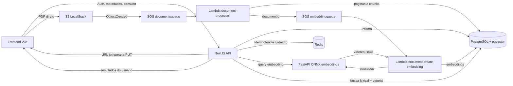

# DocFlow

DocFlow é uma aplicação para organizar documentos PDF e localizar trechos por busca lexical e semântica. O browser conversa com a API NestJS; os arquivos seguem por upload direto ao S3; LocalStack entrega eventos às Lambdas que extraem texto e geram embeddings. A API consulta PostgreSQL/pgvector para retornar resultados do usuário autenticado.

## Mapa do monorepo

| Projeto     | Responsabilidade                                                        | Documentação                             |
| ----------- | ----------------------------------------------------------------------- | ---------------------------------------- |
| `frontend/` | SPA Vue para login, registro, documentos e busca                        | [frontend/README.md](frontend/README.md) |
| `api/`      | API NestJS para autenticação, documentos, URLs pré-assinadas e pesquisa | [api/README.md](api/README.md)           |
| `infra/`    | Compose do LocalStack e serviço de embeddings; Lambdas de processamento | [infra/README.md](infra/README.md)       |

O Compose do banco PostgreSQL/pgvector e do Redis está temporariamente em `api/docker-compose.yml`. A rede Docker compartilhada `docflow` precisa existir porque os Compose da API e da infraestrutura a declaram como externa.

## Arquitetura integrada



O frontend não encaminha o conteúdo do PDF através da API. O evento S3 inicia extração e segmentação; depois outra fila inicia a criação de embeddings. O banco é compartilhado pela API e pelas Lambdas. Redis aparece no fluxo de idempotência do cadastro.

## Fluxo ponta a ponta: upload e busca

1. O usuário autentica-se no frontend. A API retorna um access token e mantém o refresh token em cookie `httpOnly`.
2. Na tela de documentos, o frontend solicita `POST /documents/upload` com metadados. A API cria um registro `QUEUED` e retorna uma URL pré-assinada temporária.
3. O browser envia o PDF diretamente ao bucket `documentsflows3`.
4. A notificação `ObjectCreated` encaminha o evento a `documentsqueue`, consumida pela Lambda `document-processor`.
5. A Lambda valida o arquivo, extrai texto por página, grava páginas e chunks no PostgreSQL e publica o `documentId` em `embeddingqueue`.
6. A Lambda `document-create-embedding` chama o serviço FastAPI/ONNX para calcular vetores e os grava no pgvector.
7. Uma busca autenticada (`POST /documents/search`) gera o embedding da consulta, combina ranking lexical e vetorial no PostgreSQL e devolve trechos filtrados pelo usuário.

O status `COMPLETED` é gravado depois da geração dos embeddings. Consulte os detalhes, endpoints e limites em [api/README.md](api/README.md) e [infra/README.md](infra/README.md).

## Pre-requisitos

- Docker Engine/Desktop com Docker Compose.
- Node.js e npm. O frontend requer Node `^22.18.0` ou `>=24.12.0`; as Lambdas usam runtime Node.js 22.
- Bash, Node, npm e `zip` para build manual das Lambdas; no Windows existe `infra/build-lambdas.bat`, que usa Docker.
- Acesso à imagem/modelo de embeddings no Hugging Face no primeiro build da imagem.
- Arquivos locais de ambiente para API, LocalStack e Lambdas, sem versionar tokens ou credenciais.

## Inicializacao local

### 1. Preparar ambiente e variaveis

Crie a rede compartilhada uma vez:

```bash
docker network create docflow
```

Copie `api/.env.example` para `api/.env`, preencha credenciais locais do banco/S3 e segredos JWT. Crie `infra/.env` com `LOCALSTACK_AUTH_TOKEN`; não há um template de infra versionado. Configure os arquivos `env.local.json` das Lambdas com `DATABASE_URL` acessível pelos containers e as variáveis de embeddings.

> Não use valores de produção localmente nem versione arquivos `.env` ou `env.local.json`. A URL de banco dentro de uma Lambda não deve usar `localhost`; consulte os requisitos de rede em [infra/README.md](infra/README.md).

### 2. Iniciar banco e Redis e aplicar migrations

```bash
cd api
npm install
docker compose up -d postgres redis
npx prisma generate --config prisma7.config.ts
npx prisma migrate deploy --config prisma7.config.ts
```

### 3. Construir e iniciar a infraestrutura

Partindo do diretório `api/` usado acima, construa cada pacote antes de iniciar o LocalStack, pois o script de inicialização consome `index.zip`:

```bash
cd ../infra/localstack/lambdas/process_document_lambda
bash build.sh
cd ../embedding_lambda
bash build.sh
cd ../../..
docker compose up -d --build
```

No Windows, os passos de build podem ser substituídos por `.\build-lambdas.bat` executado a partir de `infra/`. Esse script também executa `docker compose down -v` e recria os serviços da infra; prefira os scripts individuais se precisar preservar estado local.

### 4. Iniciar API e frontend

Em novos terminais, partindo da raiz do repositório:

```bash
cd api
npm run start:dev
```

```bash
cd frontend
npm install
npm run dev
```

O frontend espera a API em `http://localhost:3000` e o Vite normalmente serve em `http://localhost:5173`. O serviço de embeddings expõe `http://localhost:8000`; LocalStack expõe `http://localhost:4566`.

### 5. Validar recursos locais

```bash
cd infra
docker compose ps
docker compose exec localstack awslocal s3 ls
docker compose exec localstack awslocal sqs list-queues
docker compose exec localstack awslocal lambda list-functions
curl http://localhost:8000/health
```
