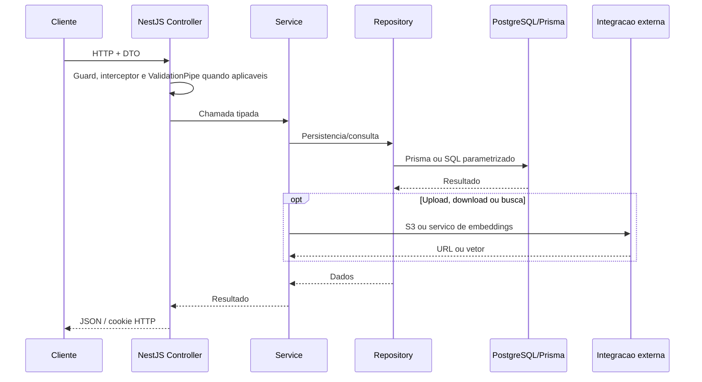

# API DocFlow

## Visao geral

A API fornece autenticação, gerenciamento de documentos e busca de conteúdo. Ela registra usuários e documentos no PostgreSQL, emite URLs pré-assinadas para upload/download no S3 e gera embeddings de consultas para pesquisar o conteúdo já processado. O processamento de PDFs é assíncrono e ocorre nas Lambdas descritas em [`../infra/README.md`](../infra/README.md).

Não há na API uma rota de pergunta e resposta com LLM: a funcionalidade de busca retorna trechos encontrados, sem gerar uma resposta conversacional.

## Stack

| Tecnologia                                | Uso observado                                                                 |
| ----------------------------------------- | ----------------------------------------------------------------------------- |
| NestJS 11 e TypeScript                    | Módulos HTTP, controllers, serviços e injeção de dependências                 |
| PostgreSQL 16 (`pgvector/pgvector`)       | Usuários, sessões, documentos, páginas, trechos e vetores                     |
| Prisma 7 com adapter `@prisma/adapter-pg` | Acesso relacional, migrations e client gerado                                 |
| Redis 8 e `ioredis`                       | Cache de respostas idempotentes do cadastro, com TTL                          |
| JWT, Passport e `bcrypt`                  | Autenticação por access token e refresh token, armazenamento de hash de senha |
| AWS SDK v3 para S3                        | URLs pré-assinadas, leitura e exclusão de objetos                             |
| `class-validator` e `class-transformer`   | Validação e transformação dos DTOs                                            |
| Docker Compose                            | Execução local do PostgreSQL/pgvector e Redis                                 |

## Arquitetura e responsabilidades

O ponto de composição é `src/app.module.ts`. Cada módulo Nest declara os controllers, providers e dependências da sua funcionalidade:

| Pasta/módulo                                  | Responsabilidade                                                                                                                           |
| --------------------------------------------- | ------------------------------------------------------------------------------------------------------------------------------------------ |
| `src/modules/auth/`                           | Rotas de cadastro, login, logout e renovação de sessão; `AuthService` aplica as regras de autenticação e `AuthRepository` persiste sessões |
| `src/modules/users/`                          | Cadastro, consulta do usuário autenticado e validação de credenciais; `UsersRepository` encapsula as operações Prisma                      |
| `src/modules/documents/`                      | Rotas de upload, listagem, resumo, busca, download e exclusão; serviço coordena repositório, S3 e embeddings                               |
| `src/modules/database/`                       | `PrismaService` instancia o client com `PrismaPg` e conecta/desconecta no ciclo de vida do Nest                                            |
| `src/modules/redis/`                          | Provider, repositório e serviço Redis; o interceptor de idempotência usa essa camada                                                       |
| `src/modules/s3-client/`                      | Configura o client S3 e concentra operações e URLs pré-assinadas                                                                           |
| `src/modules/embeddings/`                     | Chama o serviço HTTP local para gerar o vetor da consulta de busca                                                                         |
| `src/shared/`                                 | Guard JWT, decorators de usuário/token, filtro de exceções, códigos de erro e interceptor de idempotência                                  |
| `prisma/schema.prisma` e `prisma/migrations/` | Modelos relacionais, enums, extensão vetorial e alterações do banco                                                                        |
| `src/generated/prisma/`                       | Client gerado pelo Prisma; não é a fonte dos modelos. A pasta é ignorada pelo Git e deve ser gerada localmente                             |

O fluxo HTTP fica dividido entre controller (contrato e autenticação da rota), service (coordenação/regras), repository (persistência) e clients/providers (integrações externas). DTOs em `dto/` definem validações de entrada; entidades e tipos representam dados e parâmetros internos.

### Fluxo de uma requisicao



O bootstrap em `src/main.ts` instala `cookie-parser`, `AppExceptionFilter`, `ValidationPipe` com `transform: true`, CORS para `http://localhost:5173` com credenciais e inicia a API na porta `PORT` (padrão `3000`).

## Rotas implementadas

As rotas não têm prefixo global configurado.

| Método   | Rota                      | Proteção/efeito                                                               |
| -------- | ------------------------- | ----------------------------------------------------------------------------- |
| `POST`   | `/auth/register`          | Cadastro; passa pelo interceptor de idempotência e requer `x-idempotency-key` |
| `POST`   | `/auth/login`             | Valida credenciais; retorna `accessToken` e define cookie `refresh_token`     |
| `POST`   | `/auth/refresh`           | Renova access/refresh tokens e atualiza o cookie                              |
| `POST`   | `/auth/logout`            | Revoga a sessão e limpa o cookie                                              |
| `POST`   | `/auth/teste`             | Rota de teste que retorna `ola`                                               |
| `GET`    | `/users/me`               | Requer bearer token; retorna os dados básicos do usuário                      |
| `POST`   | `/documents/upload`       | Requer autenticação; cria registro e retorna URL pré-assinada de `PUT`        |
| `GET`    | `/documents`              | Requer autenticação; pagina e filtra por nome/status                          |
| `GET`    | `/documents/resume`       | Requer autenticação; contagem de documentos, trechos e páginas                |
| `GET`    | `/documents/:id`          | Requer autenticação; consulta documento do usuário                            |
| `POST`   | `/documents/search`       | Requer autenticação; recebe `searchText` e retorna trechos relevantes         |
| `GET`    | `/documents/:id/download` | Requer autenticação; retorna URL pré-assinada para download                   |
| `DELETE` | `/documents/:id`          | Requer autenticação; exclui registro e tenta excluir o objeto                 |

Os DTOs do cadastro/login usam o nome de propriedade `password` (com essa grafia). Consulte [Pontos de atencao](#pontos-de-atencao-e-melhorias-sugeridas) antes de integrar um novo cliente.

## Integracoes e fluxos

### PostgreSQL, Prisma e pgvector

`api/docker-compose.yml` executa `pgvector/pgvector:pg16` e monta volumes persistentes. O Prisma usa `DATABASE_URL`, schema em `prisma/schema.prisma` e migrations em `prisma/migrations/`. As migrations instalam `vector` e `unaccent`, adicionam vetores de 384 dimensões e criam a coluna `content_tsv` e índice GIN usados pela busca lexical.

`DocumentsRepository.searchHybrid()` combina ranking semântico (distância pgvector) e ranking lexical PostgreSQL e filtra os registros pelo `userId`. A consulta usa parâmetros SQL do Prisma. O serviço de embeddings da API envia uma consulta com `kind: "query"` ao endpoint local; a Lambda usa `kind: "passage"` para os trechos de documentos.

### Redis e idempotencia

`IdempotencyInteceptor` é aplicado ao cadastro. Requer o header `x-idempotency-key`, procura uma resposta previamente salva e, ao concluir o handler, armazena a resposta por 15 segundos com `SET ... NX`. O client conecta em `REDIS_HOST`/`REDIS_PORT`, com padrões `localhost`/`6379`.

### S3 e processamento assincrono

1. `POST /documents/upload` valida `fileName`, `type` e `size`, cria um documento em estado `QUEUED` e pede ao S3 uma URL pré-assinada para `uploads/<uuid>-<fileName>`.
2. O cliente envia o PDF diretamente ao S3 por `PUT`; os bytes não passam pelo controller da API.
3. O evento de criação do objeto segue para `documentsqueue`, depois para a Lambda `document-processor`.
4. A Lambda extrai texto e páginas, grava páginas e chunks no PostgreSQL e publica `documentId` em `embeddingqueue`.
5. A Lambda `document-create-embedding` cria os vetores e atualiza o status do documento.

O diagrama e as configurações das filas estão em [`../infra/README.md`](../infra/README.md). O bucket padrão é `documentsflows3`; as URLs pré-assinadas de upload expiram em 60 segundos e as de download em 300 segundos.

### Servico local de embeddings

`EmbeddingsService` chama `MODEL_URL` (padrão `http://localhost:8000/embeddings`), aceita vetores de 384 dimensões, normaliza o resultado e tenta novamente em falhas transitórias. O serviço FastAPI/ONNX é descrito na documentação de infraestrutura.

## Variaveis de ambiente

Crie `api/.env` a partir de `api/.env.example`; o `.env` real não deve ser versionado. Nunca coloque valores secretos neste README.

| Variável                                            | Consumidor                                     | Observação                                                                                     |
| --------------------------------------------------- | ---------------------------------------------- | ---------------------------------------------------------------------------------------------- |
| `POSTGRES_DB`, `POSTGRES_USER`, `POSTGRES_PASSWORD` | Compose do banco                               | Credenciais/nome do banco local                                                                |
| `POSTGRES_PORT`                                     | Compose do banco                               | Porta publicada no host; exemplo no arquivo é `5433`, dentro do container permanece `5432`     |
| `DATABASE_URL`                                      | Prisma e configuração Prisma                   | URL de conexão usada pela API e migrations                                                     |
| `REDIS_PORT`                                        | Compose do Redis e provider Redis              | Host publica a porta configurada; client usa `6379` por padrão                                 |
| `REDIS_HOST`                                        | Provider Redis                                 | Padrão `localhost`; variável usada pela aplicação, mas não consta no `.env.example` atual      |
| `PORT`                                              | `src/main.ts`                                  | Porta HTTP da API; padrão `3000`                                                               |
| `JWT_ACCESS_TOKEN_SECRET`                           | Auth/JWT                                       | Segredo do token de acesso                                                                     |
| `JWT_REFRESH_TOKEN_SECRET`                          | Auth/JWT                                       | Segredo do token de renovação                                                                  |
| `S3_ACCESS_ID`, `S3_SECRET_ACCESS_KEY`              | Provider S3                                    | Obrigatórios pelo provider; use credenciais apropriadas ao LocalStack em desenvolvimento       |
| `S3_ENDPOINT`                                       | Provider S3                                    | Padrão `http://localhost:4566`                                                                 |
| `S3_REGION`                                         | Provider S3                                    | Padrão `us-east-1`                                                                             |
| `S3_BUCKET`                                         | Serviço S3                                     | Padrão `documentsflows3`                                                                       |
| `MODEL_URL`                                         | `EmbeddingsService`                            | Padrão `http://localhost:8000/embeddings`                                                      |
| `EMBEDDING_MODEL`, `EMBEDDING_DIMENSIONS`           | Nenhuma referência no código da API encontrada | Estão no `.env.example`, mas a API atualmente fixa a dimensão em 384 e não lê o nome do modelo |

As variáveis do runtime das Lambdas são configuradas separadamente em `infra/localstack/lambdas/*/env.local.json`; consulte [`../infra/README.md`](../infra/README.md). Não copie credenciais entre ambientes.

## Como executar localmente

Pré-requisitos: Node.js/npm compatíveis com o projeto, Docker com Compose e uma rede Docker chamada `docflow` (os dois Compose declaram essa rede como externa).

```bash
docker network create docflow
cd api
cp .env.example .env
# Edite .env: configure credenciais, DATABASE_URL e segredos JWT.
npm install
docker compose up -d postgres redis
npx prisma generate --config prisma7.config.ts
npx prisma migrate deploy --config prisma7.config.ts
npm run start:dev
```

O endereço no `DATABASE_URL` da API executada no host normalmente usa `localhost:<POSTGRES_PORT>`. As Lambdas executadas em containers precisam alcançar o banco pelo host/gateway Docker, não por `localhost` do container; ajuste a URL no ambiente das Lambdas conforme a rede local.

Para subir LocalStack e embeddings, construa os ZIPs e siga [`../infra/README.md`](../infra/README.md). Para compilar a API, use `npm run build`; `npm run start:prod` executa `dist/main`.

### Testes

Comandos declarados no `package.json`:

```bash
npm test
npm test -- --runInBand --testPathPatterns=service.spec
npm test -- --runInBand --testPathPatterns=integration
npm run test:watch
npm run test:cov
npm run test:e2e
```

Os testes unitários ficam ao lado de cada service em `*.service.spec.ts`; os testes de
integração usam `*.integration.spec.ts`. As integrações exercitam o encadeamento de
services/repositories e substituem apenas os limites externos (banco, Redis, AWS e HTTP),
sem exigir ou alterar dados de um ambiente local.
