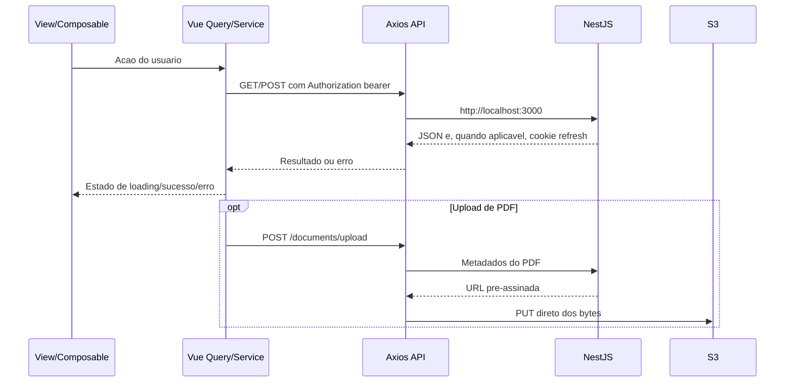

# Frontend DocFlow

## Visao geral

O frontend é uma SPA para autenticação, gerenciamento de documentos e busca de trechos. A aplicação está organizada em features Vue e consome a API NestJS; o upload dos bytes de PDF é feito diretamente para S3 usando uma URL pré-assinada retornada pela API.

## Stack

| Tecnologia                                         | Uso                                            |
| -------------------------------------------------- | ---------------------------------------------- |
| Vue 3, TypeScript e Vite                           | Interface single-page e build                  |
| Vue Router                                         | Rotas públicas e áreas protegidas              |
| Pinia                                              | Estado local de autenticação                   |
| TanStack Vue Query                                 | Mutations/queries assíncronas nas features     |
| Axios                                              | Requisições à API e upload de arquivos         |
| vee-validate, `@vee-validate/zod` e Zod            | Validação/formulários; registro usa schema Zod |
| Tailwind CSS v4 e componentes `src/components/ui/` | Estilos responsivos e controles compartilhados |
| Vue Sonner                                         | Notificações                                   |

## Organizacao e responsabilidades

```text
src/
├── components/            # Componentes compartilhados e UI
├── composables/           # Comportamentos reutilizaveis globais
├── features/
│   ├── auth/              # Views, composables, schema e servicos de autenticacao
│   ├── dashboard/         # Dashboard e seus componentes/composable
│   ├── documents/         # Views, upload, listagem, status e servicos
│   └── search/            # Busca contextual e composable
├── layouts/               # Layout autenticado com navegacao
├── router/                # Definicao de rotas e guard de autenticacao
├── services/              # Axios e servico de usuario compartilhados
├── stores/                # Pinia, incluindo sessao/autenticacao
├── lib/, shared/, types/  # Utilitarios, tipos compartilhados e constantes
└── main.ts                # Registro de plugins e montagem da aplicacao
```

Nas features, views cuidam da interface, composables coordenam estado/fluxo e services concentram chamadas de rede. Schemas Zod e tipos mantêm regras e contratos próximos ao domínio. Componentes comuns ficam fora das features para reaproveitamento.

### Responsabilidades principais

- `src/router/index.ts`: declara `/login`, `/register` e as rotas protegidas de dashboard, documentos e busca; redireciona usuários não autenticados.
- `src/stores/auth.ts`: guarda usuário e access token, persiste o token no `localStorage` e recupera o usuário com `/users/me`.
- `src/services/api.ts`: configura Axios, bearer token, cookies de credenciais e tentativa de refresh em respostas 401.
- `src/features/auth/`: login/registro; `useLogin` coordena a mutation e atualiza o store de autenticação; `useRegister` usa schema Zod e serviço de registro.
- `src/features/documents/`: listagem e upload; o composable valida tipo/tamanho, solicita URL pré-assinada e acompanha progresso do `PUT`.
- `src/features/search/`: envia consulta à API e apresenta resultados.
- `src/components/ui/`: controles como botão, input, card, tabela e toast, usados pelas páginas.
- `src/lib/get-error-message.ts`: converte o formato de erro da API em mensagens para a interface.

## Comunicacao com a API



`src/services/api.ts` atualmente define `baseURL` como `http://localhost:3000/`, `timeout` de 5 segundos e `withCredentials: true`. O access token é colocado no header `Authorization`; o refresh token é mantido pelo backend em cookie `httpOnly`. Ao receber 401 em uma rota protegida, o interceptor tenta `/auth/refresh`, atualiza o token e repete a requisição.

O tratamento de mensagens usa `getErrorMessage()`, que reconhece códigos de erro Axios e o objeto retornado pelo filtro da API. Dados assíncronos e estados de mutations usam TanStack Vue Query; o estado do usuário/token fica no Pinia.

### Cadastro e integracao pendente

A tela de registro apresenta `name`, `email` e `password` e valida com `registerSchema` via vee-validate/Zod. O serviço `features/auth/services/register.ts` é um stub que lança erro indicando que a integração não está configurada; ele não faz `fetch`, Axios nem outra chamada. Portanto, **o formulário não conclui cadastro contra o backend atualmente**.

O backend oferece `POST /auth/register`, mas espera `passworld` (grafia do DTO atual) e requer o header `x-idempotency-key`. Antes de ligar o serviço, alinhe o nome do campo e envie uma chave de idempotência. Consulte os detalhes do endpoint e do fluxo em [`../api/README.md`](../api/README.md).

## Variaveis de ambiente

Não foi encontrado arquivo `.env*` no frontend, nem configuração de `VITE_*` no `vite.config.ts`. A URL da API é atualmente fixa em `src/services/api.ts`. Para apontar o frontend a outro host, será necessário ajustar essa configuração em tarefa própria; não existe variável configurável no estado atual.

## Executar, compilar e validar

Pré-requisitos: Node.js `^22.18.0` ou `>=24.12.0` (conforme `package.json`) e npm.

```bash
npm install
npm run dev
```

O Vite inicia o servidor de desenvolvimento, normalmente em `http://localhost:5173`, origem permitida pelo CORS atual da API.

Comandos disponíveis:

| Comando              | Resultado                                                                      |
| -------------------- | ------------------------------------------------------------------------------ |
| `npm run build`      | Executa `type-check` e `build-only` em paralelo                                |
| `npm run build-only` | Gera o build de produção com Vite                                              |
| `npm run type-check` | Verifica tipos Vue/TypeScript                                                  |
| `npm run preview`    | Serve localmente o build                                                       |
| `npm run lint`       | Executa Oxlint e ESLint; os scripts incluem `--fix` e podem modificar arquivos |
| `npm run format`     | Formata `src/` com Prettier                                                    |
